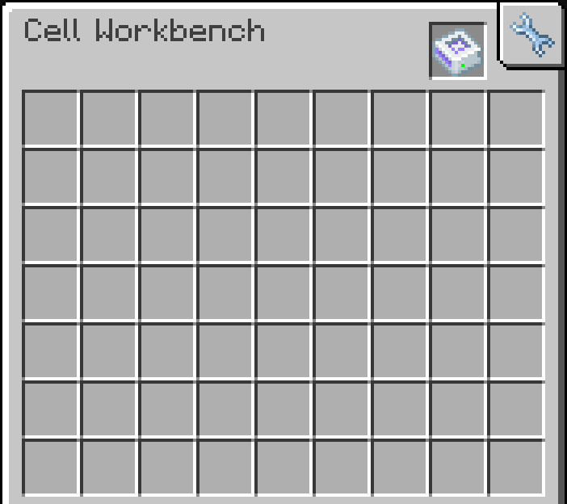
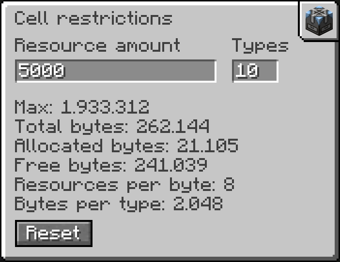

# Restricted Cells

An add-on for [AE2 UELM](https://www.curseforge.com/minecraft/mc-mods/ae2-unofficial-extended-life-modern) (Minecraft 1.20.1, Forge) that adds storage cells with adjustable limits. Each cell can cap the total amount of resources it stores and the number of types it holds. You set both caps in the Cell Workbench. The idea comes from the cell restriction in [GTNH's AE2](https://github.com/GTNewHorizons/Applied-Energistics-2-Unofficial).

It only works with UELM, not with the original AE2, because the Cell Workbench screen is extended through an API that only UELM has.

<div align="center">
  
  
</div>

## Features

- Item and fluid cells from 1k to 256k, standard and portable
- A cap on the total resources and a cap on the types. With an Equal Distribution Card the resource cap applies to each type
- Set in the Cell Workbench through the wrench tab in the top right corner
- MEGA Cells: item and fluid cells from 1M to 256M, standard and portable
- Applied Mekanistics: chemical cells from 1k to 256k, standard and portable, and 1M to 256M with MEGA Cells
- Expanded AE: dual cells and Artificial Universe cells
- Crafted from the normal cell and a Logic Processor, keeping contents, partition, upgrades and energy. Sneak and right-click turns it back
- An in-game guide in English and German

## Requirements

- Minecraft 1.20.1 and Forge 47.1.3 or newer
- [AE2 UELM](https://www.curseforge.com/minecraft/mc-mods/ae2-unofficial-extended-life-modern) 15.5 or newer
- Optional: [MEGA Cells](https://www.curseforge.com/minecraft/mc-mods/mega-cells) 2.4.6 or newer, [Applied Mekanistics](https://www.curseforge.com/minecraft/mc-mods/applied-mekanistics) 1.4.3 or newer, [Expanded AE](https://www.curseforge.com/minecraft/mc-mods/expanded-ae) 1.4.3 or newer

Without the optional mods, their cells are not added.

## Not included

Cells that hold a single type, such as mana, source or FE cells, because a types limit does nothing for them.

## Building

You need Java 17.

```
./gradlew build
./gradlew runClient
./gradlew runData
```

The dev client loads MEGA Cells, Expanded AE and Applied Mekanistics. `runtime_cell_addons` in `gradle.properties` changes that. See [CONTRIBUTING.md](.github/CONTRIBUTING.md) for more.

## Credits

Thanks to the AE2 team and Kolja for the [UELM fork](https://github.com/AE2-Unofficial-Extended-Life-Modern/AE2-UELM), and to the authors of [MEGA Cells](https://github.com/62832/MEGACells), [Applied Mekanistics](https://github.com/AppliedEnergistics/Applied-Mekanistics) and [Expanded AE](https://github.com/ko-lja/expandedae), whose cell art this builds on. The cell inventory is adapted from AE2.

## License

The code is [LGPL-3.0-or-later](https://www.gnu.org/licenses/lgpl-3.0.html), see [LICENSE](LICENSE). The textures and models are modified art from AE2, MEGA Cells, Applied Mekanistics and Expanded AE under [CC BY-NC-SA 3.0](https://creativecommons.org/licenses/by-nc-sa/3.0/), so they are for non-commercial use. Expanded AE states no separate asset license. [NOTICE.md](NOTICE.md) lists the sources and the changes.
