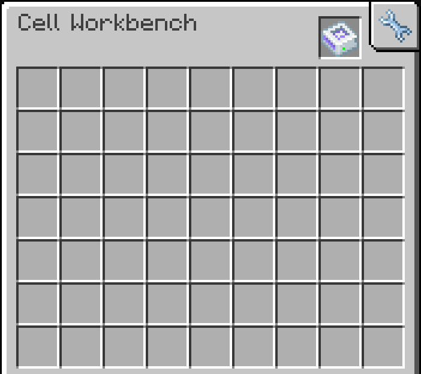
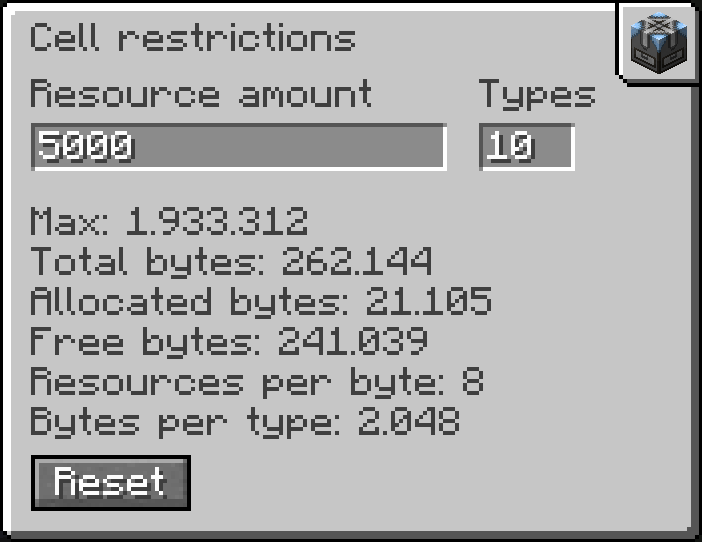

---
navigation:
  title: Restricting a Cell
  parent: restrictedcells-index.md
  icon: ae2:cell_workbench
  position: 20
---

# Restricting a Cell

&nbsp;

<Row>
  <ItemImage id="ae2:cell_workbench" scale="4" />

  <ItemImage id="ae2:certus_quartz_wrench" scale="4" />
</Row>

&nbsp;

1.  Put a [Restricted Cell](restricted-cells.md) in the <ItemLink id="ae2:cell_workbench" />.
2.  Click the wrench tab in the top right corner. It stays greyed out until the slot holds a Restricted Cell.
3.  Enter your limits. They apply as you type.

&nbsp;

&nbsp;

## Restrictions Screen

&nbsp;

&nbsp;

*   **Resource amount** is the most resources the cell stores. You can enter the suffixes k, M, G and T, such as `5k` or `2.5M`, and simple math such as `2*1000`.
*   **Types** is the most types the cell holds.
*   An empty field counts as 0, which means no limit.
*   **Reset** clears both limits.

The lines below the fields show the cell's capacity. **Max** is the highest amount you can enter. Every allowed type
reserves its bytes up front, so allowing fewer types raises **Max**. The screen clamps your input to what the cell can
hold.

With an <ItemLink id="ae2:equal_distribution_card" /> installed, **Resource amount** applies to each type. See
[Equal Distribution](equal-distribution.md).
